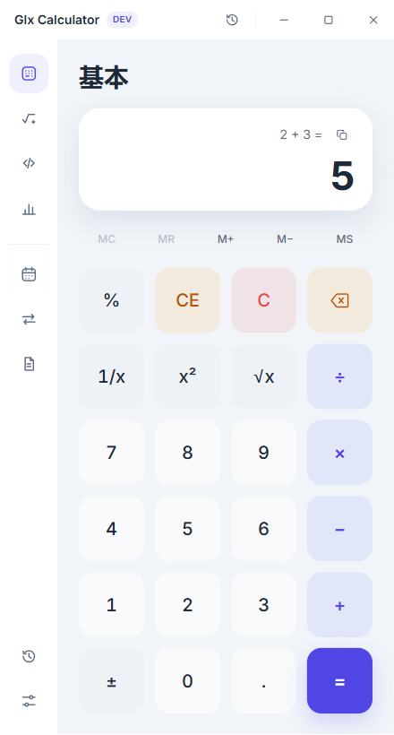
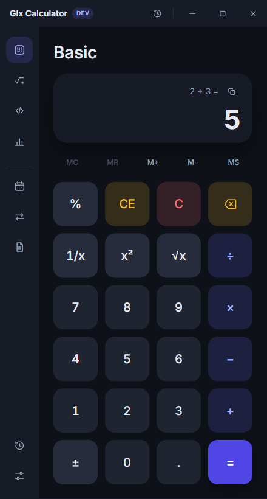

# Glx Calculator

一个键盘优先的 Windows 桌面计算器：Tauri 2 外壳 + Rust 计算内核 + React 19 / TypeScript 前端。支持标准、科学、程序员、统计、日期、单位/汇率转换与常用财务工作表，提供中英双语、深浅主题、DPI 与 Windows 文本大小适配。

| 浅色 / 中文 | 深色 / English |
|---|---|
|  |  |

## 功能

- **7 个页面**：基本、科学型、程序员、统计型、日期计算、单位转换、工作表。
- **基本 / 科学**：表达式优先级、括号、幂与右结合、百分比、记忆、退格/CE/C、重复 `=`；科学函数含三角/双曲/对数/阶乘/随机，DEG-RAD-GRAD 与 F-E 显示。
- **程序员**：64/32/16/8 位字宽，HEX/DEC/OCT/BIN 同步视图，位运算、移位、循环移位、补码与可点击位网格。
- **统计**：列表式数据集，求和/均值/中位数/众数/极差/标准差/方差，录入/编辑/删除/排序。
- **日期**：日期差（年/月/日、总天数、总周数）与日期加减，日历弹层支持闰年与月末夹取。
- **单位转换**：11 类单位与交叉换算；汇率取自欧洲央行（ECB）每日参考价，24 小时缓存，离线回退。
- **工作表**：抵押贷款、油耗、租赁，字段级校验与金额两位小数。
- **通用能力**：历史记录（按模式隔离、可配置上限）、系统剪贴板与右键菜单、`F1` 快捷键说明、`Ctrl+H` 历史、`Ctrl+C/V`。
- **外观与无障碍**：浅色/深色/跟随系统，zh-CN/en-US 即时切换，100–200% DPI，Windows 文本大小 100–150%，键盘全流程、跳转链接、焦点环与图标按钮可访问名称。

完整功能与交互口径见 [HANDOFF](PLAN/TODO/01-Addfeatures/HANDOFF.md)，视觉规范见 [design.md](PLAN/UIDesign/soft-ui/design.md)。

## 环境要求

**运行**

- Windows 10/11 或 Windows Server 2022+（x64）。
- Microsoft Edge WebView2 Runtime。安装包使用 silent `downloadBootstrapper`：Win10/11 通常自带；离线机器或 Server 需预装 Evergreen Runtime。

**构建**

- Rust 1.85+（`x86_64-pc-windows-msvc`）与 Visual Studio 2022 C++ 工具链。
- Node.js >= 22 与 npm 11。
- WebView2 Runtime。

本仓库开发机把 Node 放在 `E:\node` 且可能不在 PATH；Git Bash 下先执行：

```bash
export PATH="/e/node:$PATH"
```

## 开发

```bash
npm install
npm run tauri dev     # 启动 Tauri + Vite
npm run dev           # 仅前端预览（浏览器内不执行计算）
```

质量门禁（与 CI 一致）：

```bash
cargo fmt --all -- --check
cargo clippy --workspace --all-targets -- -D warnings
cargo test --workspace
npm run typecheck
npm run lint          # oxlint
npm run check:i18n
npm run test          # Vitest
npm run build
```

当前基线：Rust 246 项、前端 196 项（25 文件），lint 0 warning。

## 打包

```bash
npm run tauri build
```

产物位于 `src-tauri/target/release/bundle/`：

- **NSIS**：`Glx Calculator_0.1.0_x64-setup.exe`，`currentUser` 安装，免提权，提供 English / 简体中文 语言选择。
- **MSI**：`Glx Calculator_0.1.0_x64_en-US.msi` / `_zh-CN.msi`，`perMachine`，需要管理员。
- release 配置：`opt-level="s"`、thin LTO、`codegen-units=1`、`strip`、`panic=abort`；exe 约 6.81 MB。

## 架构

```
crates/calc-core    纯 Rust 计算内核（值/解析/引擎/各模式运算/单位/日期/工作表），不依赖 Tauri
src-tauri           Tauri 命令层（会话、设置、历史、剪贴板、汇率、DPI），薄适配 + 持久化
src                 React 19 UI（页面、组件、i18n、主题、Zustand 状态）
scripts             check-i18n.mjs（两份语言文件键集合/占位符校验）
docs/qa             逐任务 QA 记录与截图
```

- **精度**：金额与常规运算使用 `rust_decimal`；科学函数与超大数走 f64（15 位有效数字，保留 E 记法）。
- **状态**：基本/科学/程序员/统计为 Rust 端有状态会话（每模式一个），前端只渲染视图。
- **汇率**：`https://www.ecb.europa.eu/stats/eurofxref/eurofxref-daily.xml`，基准 EUR，每日更新；缓存 24 小时。
- **本地数据**（`%APPDATA%\com.glx.calculator\`）：`settings.json`、`history.json`、`currency-cache.json`、`.window-state.json`。

## QA 与文档

- [v0.1.0 发布说明](docs/release/v0.1.0.md)：功能、安装、产物校验和、已知问题、数据来源。
- [T18 合并回归矩阵](docs/qa/2026-11-19/T18-QA-MATRIX.md)：功能、主题/语言、DPI、文本缩放、键盘、已知问题。
- [逐任务 QA 记录](docs/qa/2026-11-19/README.md)：T3–T18 的方法、结果与截图。
- [任务计划与实施记录](PLAN/TODO/01-Addfeatures/HANDOFF.md)。

## 已知问题与限制

1. **MSI 需要管理员**：`perMachine` 安装，非管理员 `/qn` 会被系统策略拒绝（1625）；普通用户请用 NSIS。
2. **未签名**：未配置代码签名证书，SmartScreen 可能提示。
3. **WebView2 离线**：silent bootstrapper 需要联网；离线部署请预装 Evergreen Runtime。
4. **文本大小上限 150%**：440px 紧凑窗口不保证 200–225% 下 6 列键盘可读。
5. **双屏混合 DPI 未实测**：当前验证基于单活动桌面与 WebView2 设备缩放。
6. **中文输入法未实测**：测试机未安装 IME，组合输入行为需在装有 Pinyin 的环境复验。
7. **ECB 汇率非实时**：每日参考价、29 种货币、基准 EUR，不含 RUB；离线使用缓存并提示。
8. **无自动更新**：新版本需手动下载。标题栏保留 `DEV` 徽标（设计稿元素；≥120% 文本大小时自动隐藏，T19 决定保留）。
9. **移动端不提供**：仅构建 Windows 桌面目标。

## 版本与许可

- 版本：`0.1.0`（首个发布版本；变更、安装与校验和见 [docs/release/v0.1.0.md](docs/release/v0.1.0.md)）。
- 产物归档：`release/v0.1.0/`（本地保留，不入库）。
- 许可：MIT（见根 [Cargo.toml](Cargo.toml) 的 workspace 声明）。